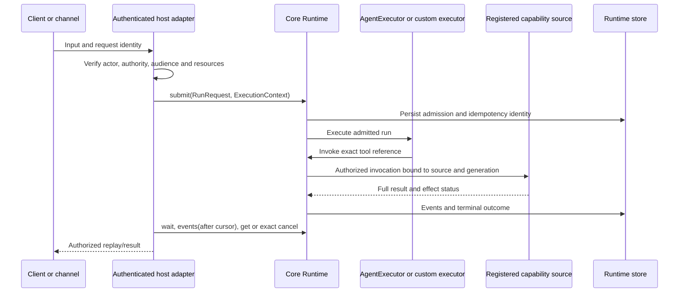

# Core components and communication

Source map reviewed **2 November 2026**. This describes the current checkout's
public boundaries; package manifests and release receipts decide exact versions.
Read [agnostic architecture](AGNOSTICISM.md) before implementing an extension.

## Repository boundaries

| Repository | Owns | Does not require |
| --- | --- | --- |
| `openagent-core` | Kernel/runtime, optional reasoning engine and modules, stores, gateway and SDK | Standalone server, product identity, computer tools |
| `openagent-tools` | Independent tool protocol, tools, process execution, sidecars and connector SDK/runner | Agent loop, model, vault or standalone UI |
| `openagent` | Standalone App/CLI/server/MCP bridge and explicit composition of Core/Tools | Embedding applications or their deployment code |

These are independent versioned repositories, not interchangeable source trees.
An embedded host imports Core directly; a remote client uses the host's public
gateway. Installing the standalone product is a third, separate choice.

## Kernel and engine are different layers

The **kernel** is in `packages/runtime/src/openagent_core`: `contracts.py`,
`runtime.py`, `modules.py`, `capabilities.py` and public exports in `__init__.py`.
It owns instance lifecycle, verified execution context, authorization, durable
admission/events, mandatory session substrate, module graph, prompt composition
and capability dispatch. `RuntimeSettings` and `RuntimeServices` receive explicit
dependencies. Import and construction do not start a listener, process or model.

The optional **engine** is exposed through `openagent_core.engine`: `Agent`,
`AgentExecutor`, `MemoryDB`, `ModelDispatcher`, `MCPPool` and related adapters.
It supplies the model-driven reasoning algorithm. Hosts select engine extras,
models, resources and credentials; `AgentExecutor` connects that algorithm to
the same Runtime admission/cancellation/history path. A custom executor can use
the kernel without installing the engine. Do not copy the agent loop into a host.

## Package and directory map

| Directory / distribution | Contract and role |
| --- | --- |
| Root `pyproject.toml`, `packages/runtime/` / `openagent-core` | Dependency-free public kernel; optional `engine`, `providers`, `audio`, `retrieval`, `modules` extras |
| `packages/storage-sqlite/` / `openagent-storage-sqlite` | Operational run/session/event store; explicit path, lifecycle and writer ownership |
| `packages/module-*/` / `openagent-module-*` | Optional Sessions, Search, Vault, MCP, Workflows, Scheduler, Events, Delegation, Skills, Models, Budget, Attachments, Logs, PTC and Tool Discovery |
| `packages/module-full/` / `openagent-modules-full` | Dependency bundle; installation alone activates no module |
| `packages/modules/` / `openagent-modules` | Compatibility implementations/resources during the modular transition |
| `packages/gateway/` / `openagent-gateway` | Optional aiohttp transport around Runtime; host supplies authenticated context resolver |
| `sdk/python/` / `openagent-sdk` | `RunClient`, request/result/event types, uncertain-acceptance handling |
| `sdk/typescript/` / `@openagent/sdk` | Equivalent HTTP run client for JavaScript/TypeScript |
| `packages/capability-host/` / `openagent-capability-host` | Optional engine-free capability hosting, consent, admission, leases and MCP process lifecycle |
| `tests/public/`, `docs/` | Public-contract regressions and detailed contracts |

`RuntimeProfile` selects module descriptors and surfaces: `service`,
`agent_tools`, `host_api`, `workers`, `event_ingress`. Resolution validates
dependencies before activation. `Runtime.reconfigure` swaps a validated graph
generation; it does not install a wheel. Disabling a module is not data deletion.
The Sessions administration module is optional; the kernel's SessionStore is not.

## How calls cross the boundaries

Capability sources may be Python functions, external MCP, a tool host or a
verified client device. They share `CapabilityCatalog` and opaque `tool_ref`
dispatch; tool arguments cannot select another principal, source or computer.
The capability host is optional, not a mandatory hop for every Python function.

For remote use, `openagent_gateway.create_app(runtime, resolve_context)` exposes
`/api/v1/runs`; `RunClient` submits/reads/replays/cancels through those routes.
The resolver is an async context manager supplied by trusted host code. The
request body cannot supply a principal or lease. Python and TypeScript clients
use the same wire contract. This HTTP gateway is distinct from the standalone
product's identity/network transport, which composes Runtime separately.

## Lifecycle, storage and runner ownership

Call `start`, submit authorized work, reconcile terminal events, then `close`.
Use one writer per SQLite store; do not mount the same live writer database into
independent Runtime instances. Repeating a request uses the same run and
idempotency identity; an uncertain effect is reconciled rather than duplicated.
An observer disconnect does not cancel an admitted run. Cancellation names that run.

Runtime schedules and supervises admitted agent work; optional domain workers
activate with their modules. OS/process execution is a separate CodeExecutor
contract whose reusable implementations live in Tools. Hosts provision any
sandbox and resource budget explicitly. MCP sources own their own transport
processes; the native sidecar is not the agent engine or a scheduler.

## Current import-boundary debt

The reviewed SQLite source adapter reaches an eager MemoryDB import through
its migration helpers; it currently needs engine dependencies in an otherwise
minimal environment. That does not make the kernel dependent on the standalone
product. See [the exact source limitation and run prerequisites](USAGE.md) before
using the demo or claiming a minimal adapter install.

## Using the components

Follow [usage and executable examples](USAGE.md), then the detailed contracts:
[architecture](architecture.md), [modules](modules-v1.1.md),
[capability catalog](tool-catalog.md), [code execution](code-execution.md),
[management](management-inprocess.md), [session history](session-history.md).
Standalone composition is documented in the
[product component guide](https://github.com/openagent-uno/openagent/blob/main/docs/COMPONENTS.md);
tool execution is documented in the
[Tools component guide](https://github.com/openagent-uno/openagent-tools/blob/main/docs/COMPONENTS.md).
